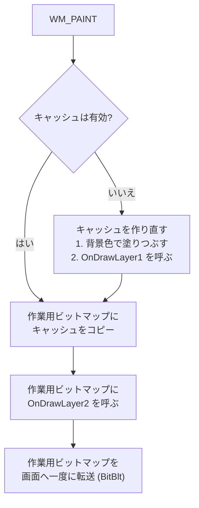
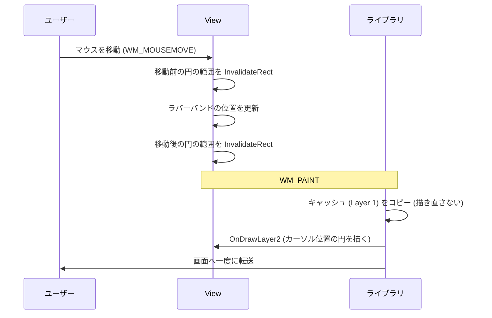
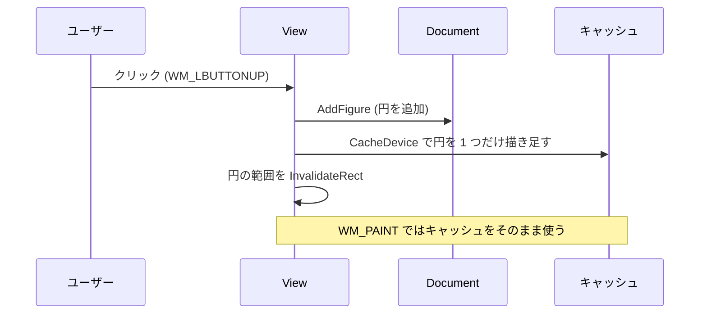
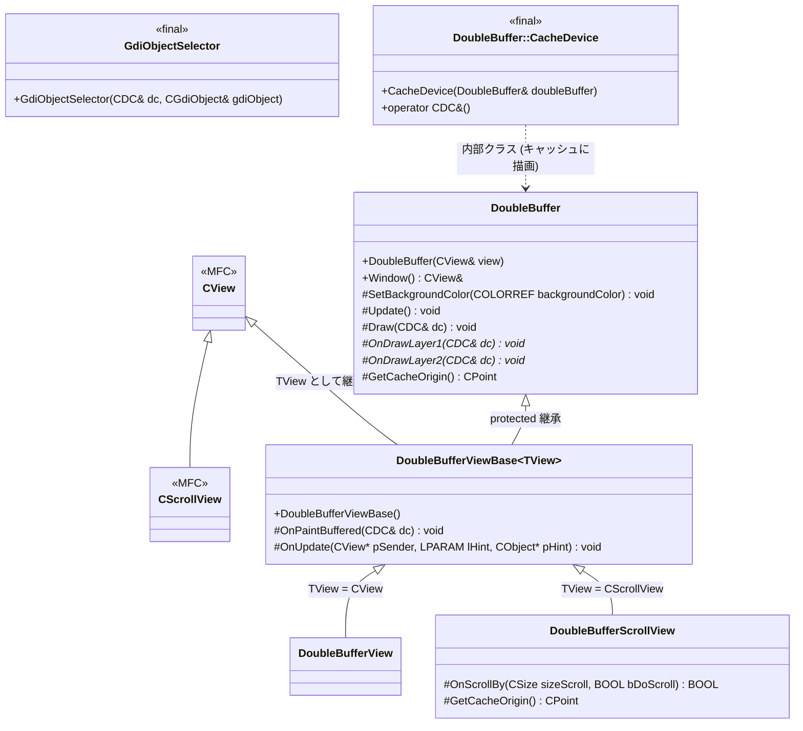
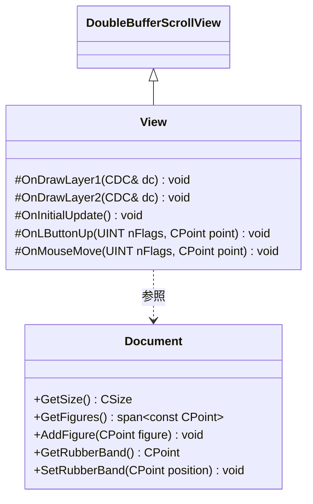

# [C++/MFC] MFCDoubleBuffer

Double Buffering Library for MFC Applications

MFC のビュー (`CView` / `CScrollView`) に、**ちらつきのない描画**と**描画内容のキャッシュ**を追加するライブラリ (MFC 拡張 DLL) です。
ビューの基底クラスを差し替え、`OnDraw` の代わりに 2 つの描画メソッドをオーバーライドするだけで使えます。

## 目次

- [ダブルバッファリングとは](#ダブルバッファリングとは)
  - [なぜちらつくのか](#なぜちらつくのか)
  - [ダブルバッファリングの効果](#ダブルバッファリングの効果)
  - [このライブラリの工夫: 2 層の描画](#このライブラリの工夫-2-層の描画)
- [仕組み](#仕組み)
  - [WM_PAINT 時の処理の流れ](#wm_paint-時の処理の流れ)
  - [キャッシュが無効になるタイミング](#キャッシュが無効になるタイミング)
  - [Layer 1 を更新する 2 つの方法](#layer-1-を更新する-2-つの方法)
- [使い方](#使い方)
- [サンプルの解説](#サンプルの解説)
- [クラス図](#クラス図)
- [API 一覧](#api-一覧)
- [ビルド方法](#ビルド方法)
- [制限事項](#制限事項)
- [ライセンス](#ライセンス)

---

## ダブルバッファリングとは

### なぜちらつくのか

MFC の標準的な描画 (`OnDraw`) では、ウィンドウを再描画するときに次のことが**画面上で直接**行われます。

1. `WM_ERASEBKGND` で背景が消去される (一瞬、何も描かれていない状態になる)
2. `OnDraw` で図形が 1 つずつ描かれる (描きかけの状態が見える)

再描画が 1 秒間に何十回も起きると (マウスに追従する表示やスクロールなど)、この「消えた状態」や「描きかけの状態」が目に見えてしまい、画面がちらつきます。

### ダブルバッファリングの効果

ダブルバッファリングでは、画面の代わりに**画面外のビットマップ (バッファー)** に描画し、描き終わった結果を**一度に画面へ転送** (`BitBlt`) します。

| | 直接描画 | ダブルバッファリング |
|---|---|---|
| 描画先 | 画面 | 画面外のビットマップ |
| 画面に見えるもの | 消去 → 描きかけ → 完成 | 完成した状態だけ |
| ちらつき | 起きる | 起きない |

### このライブラリの工夫: 2 層の描画

単純なダブルバッファリングでは、再描画のたびにすべての図形を描き直します。図形が多いと、それだけで重くなります。

そこでこのライブラリでは、描画内容を 2 つの層に分けます。

| 層 | オーバーライドするメソッド | 向いている内容 | 描かれるタイミング |
|---|---|---|---|
| **Layer 1** | `OnDrawLayer1(CDC&)` | あまり変化しないもの (確定した図形、背景の図など) | キャッシュを作り直すときだけ |
| **Layer 2** | `OnDrawLayer2(CDC&)` | 頻繁に変化するもの (ラバーバンド、カーソル位置の表示など) | 再描画のたびに毎回 |

Layer 1 はビットマップ (**キャッシュ**) に保存されるので、マウスを動かすたびに再描画しても、Layer 1 は描き直さずにキャッシュから転送するだけで済みます。
**ちらつき防止**と**描画コストの削減**を同時に実現できます。

---

## 仕組み

### WM_PAINT 時の処理の流れ



- キャッシュと作業用ビットマップは、どちらも画面外にあります。画面に転送されるのは、最後の 1 回だけです。
- 作業用ビットマップは、再描画が必要な範囲 (クリップ ボックス) の大きさだけ確保します。
- 背景の消去 (`WM_ERASEBKGND`) は何もしません。背景はキャッシュを作るときに塗りつぶします。
- `OnDrawLayer1` / `OnDrawLayer2` に渡される `CDC` は `OnPrepareDC` が適用済みです。`OnDraw` と同じように**論理座標**で描けます (スクロールの位置は考慮済み)。

### キャッシュが無効になるタイミング

キャッシュは、次のときに自動的に無効になり、次の `WM_PAINT` で作り直されます。

| きっかけ | 処理しているメソッド |
|---|---|
| ドキュメントの更新 (`UpdateAllViews` など) | `OnUpdate` |
| ウィンドウの大きさの変更 | `OnSize` |
| スクロール (スクロール バー、マウス ホイール) | `OnScrollBy` (`DoubleBufferScrollView` のみ) |
| `ScrollToPosition` などによるスクロール位置の変更 | 描画時にスクロール位置の変化を検知 |
| 背景色の変更 | `SetBackgroundColor` |
| 利用者が明示的に呼ぶ | `Update()` |

> `DoubleBufferScrollView` のキャッシュは、**表示されている部分だけ**を保持しています。そのため、スクロールするたびに Layer 1 を描き直します。

### Layer 1 を更新する 2 つの方法

Layer 1 の内容が変わったときは、次のどちらかの方法で画面に反映します。

| 方法 | 手順 | 向いている場面 |
|---|---|---|
| **全体を作り直す** | `Update()` → `Invalidate(FALSE)` | 内容が大きく変わったとき (削除、並べ替えなど) |
| **差分だけを描き足す** | `CacheDevice` に描画 → `InvalidateRect(範囲, FALSE)` | 図形を 1 つ追加したときなど |

`CacheDevice` は、キャッシュのビットマップに直接描くための DC です。全体を作り直すより、ずっと軽い処理で済みます。

```cpp
// キャッシュに、追加した図形だけを描き足す (point は論理座標)
DrawFigure(CacheDevice(*this), point);
// その範囲だけを再描画する (デバイス座標で指定する)
InvalidateRect(&area, FALSE);
```

> `Invalidate` / `InvalidateRect` の第 2 引数は `FALSE` (背景を消去しない) にしてください。

---

## 使い方

1. ビューの基底クラスを `Shos::MFCDoubleBuffer::DoubleBufferView` (`CView` 版) または `Shos::MFCDoubleBuffer::DoubleBufferScrollView` (`CScrollView` 版) にします。
2. `OnDraw` の代わりに、`OnDrawLayer1` と `OnDrawLayer2` をオーバーライドします。
3. Layer 1 の内容が変わったら、[Layer 1 を更新する 2 つの方法](#layer-1-を更新する-2-つの方法) のどちらかで反映します。
4. Layer 2 の内容が変わったら、該当する範囲を `InvalidateRect(範囲, FALSE)` します。
5. 必要なら、コンストラクターで `SetBackgroundColor` を呼んで背景色を設定します (既定はシステムのウィンドウ色)。

```cpp
#include "MFCDoubleBuffer.h"

class MyView : public Shos::MFCDoubleBuffer::DoubleBufferScrollView
{
    DECLARE_DYNCREATE(MyView)

public:
    MyView()
    { SetBackgroundColor(RGB(0xff, 0xff, 0xff)); }

protected:
    // あまり変化しない内容 (キャッシュされる)
    void OnDrawLayer1(CDC& dc) override
    {
        for (const auto& item : GetDocument()->GetItems())
            item.Draw(dc);
    }

    // 頻繁に変化する内容 (毎回描かれる)
    void OnDrawLayer2(CDC& dc) override
    { DrawCursorMark(dc); }

    DECLARE_MESSAGE_MAP()
};

// MyView.cpp
IMPLEMENT_DYNCREATE(MyView, Shos::MFCDoubleBuffer::DoubleBufferScrollView)

BEGIN_MESSAGE_MAP(MyView, Shos::MFCDoubleBuffer::DoubleBufferScrollView)
    // WM_PAINT / WM_ERASEBKGND / WM_SIZE は基底クラスで処理済みなので、登録しない
END_MESSAGE_MAP()
```

> **注意**
> - `OnDraw` はオーバーライドしないでください (ライブラリ側で使っていません)。
> - `OnUpdate` / `OnSize` / `OnScrollBy` をオーバーライドするときは、必ず基底クラスの同じメソッドを呼んでください。キャッシュが無効にならなくなります。
> - `GdiObjectSelector` を使うと、ペンやブラシの選択を元に戻し忘れることを防げます (下記の [API 一覧](#api-一覧) を参照)。

---

## サンプルの解説

`MFCDoubleBufferingSample` は、クリックした位置に円を配置していく SDI アプリケーションです。

| 操作 | 画面の動き | 使っているライブラリの機能 | コード |
|---|---|---|---|
| マウスを動かす | カーソルの位置に円が追従する | **Layer 2** (`OnDrawLayer2`) | `View::OnMouseMove` |
| クリックする | その位置に円が配置される | **差分の描き足し** (`CacheDevice`) | `View::OnLButtonUp` |
| ウィンドウの再描画 | 配置済みの円が表示される | **Layer 1** (`OnDrawLayer1`) とキャッシュ | `View::OnDrawLayer1` |
| スクロール | 表示範囲が移動する | `DoubleBufferScrollView` | (ライブラリ側で自動処理) |
| 新規作成 / 開く / 保存 | 円の一覧を作成・読み書きする | `OnUpdate` によるキャッシュの自動無効化 | `Document` |

### ファイル構成

| ファイル | 内容 |
|---|---|
| `View.h` | ビュー。ライブラリの使い方の中心となる例 |
| `Document.h` | ドキュメント。配置した円の中心座標の一覧と、ラバーバンドの位置を保持する |
| `Application.h` / `.cpp` | アプリケーション。ドキュメント・フレーム・ビューの組み合わせを登録する |

### マウスを動かしたとき (Layer 2 の例)

カーソルの位置の円は Layer 2 に描くので、マウスを動かすたびに再描画しても、配置済みの円 (Layer 1) は描き直されません。



### クリックしたとき (CacheDevice の例)

キャッシュ全体を作り直す代わりに、追加した円だけをキャッシュに描き足します。



### 座標の扱い

マウスの位置は**デバイス座標** (ウィンドウの左上が原点) で届きますが、ドキュメントには**論理座標** (スクロールを考慮した座標) で保存します。
サンプルでは `DPtoLP` / `LPtoDP` で変換しています。`InvalidateRect` に渡す範囲はデバイス座標で指定する点に注意してください。

---

## クラス図

利用者が使う型とメンバーだけを載せています (`+` は public、`#` は派生クラスから使う protected)。
すべての型は名前空間 `Shos::MFCDoubleBuffer` にあります。



- 斜体 (`*`) のメソッドは、派生クラスでオーバーライドする仮想関数です。
- `DoubleBufferViewBase<TView>` の `TView` は、`CView` の派生クラスに限られます (C++20 の concept `std::derived_from<CView>`)。
- 利用者は通常、`DoubleBufferView` または `DoubleBufferScrollView` を継承します。

サンプルのクラスとの関係は次のとおりです。



---

## API 一覧

### `DoubleBufferView` / `DoubleBufferScrollView` (派生クラスから使うもの)

| メンバー | 説明 |
|---|---|
| `virtual void OnDrawLayer1(CDC& dc)` | **オーバーライドする。** Layer 1 (キャッシュされる層) を描く。キャッシュを作り直すときだけ呼ばれる |
| `virtual void OnDrawLayer2(CDC& dc)` | **オーバーライドする。** Layer 2 (毎回描く層) を描く。再描画のたびに呼ばれる |
| `void Update()` | キャッシュを無効にする。作り直すのは次の `WM_PAINT` のとき。すぐ反映するには続けて `Invalidate(FALSE)` を呼ぶ |
| `void SetBackgroundColor(COLORREF color)` | Layer 1 の背景色を設定する (キャッシュも無効になる) |
| `class CacheDevice` | キャッシュに直接描くための DC。`CDC&` に変換できる。`OnPrepareDC` 適用済みなので論理座標で描ける |
| `virtual void OnPaintBuffered(CDC& dc)` | `WM_PAINT` 時の描画処理。描画の前後に処理を追加したいときにオーバーライドする (中で基底クラスのメソッドを呼ぶこと) |
| `CView& Window()` | 描画対象のビュー自身を返す |

### `GdiObjectSelector`

GDI オブジェクト (ペン、ブラシなど) を DC に選択し、スコープを抜けるときに元のオブジェクトへ自動的に戻すクラスです。

```cpp
CPen pen(PS_SOLID, 0, RGB(0, 0, 0));
GdiObjectSelector penSelector(dc, pen);      // pen を選択
CBrush brush(RGB(0, 0, 255));
GdiObjectSelector brushSelector(dc, brush);  // brush を選択
dc.Ellipse(&area);
// スコープを抜けると、ブラシ → ペンの順に元へ戻る (デストラクターで自動的に戻す)
```

---

## ビルド方法

### 動作環境

| 項目 | 内容 |
|---|---|
| IDE | Visual Studio 2026 (Platform Toolset v145) |
| 言語 | C++20 |
| MFC | 共有 DLL で MFC を使用 (Unicode) |
| プラットフォーム | x64 / Win32 |

### 手順

1. `MFCDoubleBuffer.sln` を開いてビルドします (ライブラリ → サンプルの順に自動でビルドされます)。
2. ライブラリのビルド後、ポストビルド イベントで次のファイルがコピーされます。
   - `MFCDoubleBuffer/MFCDoubleBuffer.h` → `include/`
   - `MFCDoubleBuffer.lib` (インポート ライブラリ) → `lib/`

### ディレクトリ構成

| パス | 内容 |
|---|---|
| `MFCDoubleBuffer/` | ライブラリ (MFC 拡張 DLL) のプロジェクト |
| `MFCDoubleBufferingSample/` | サンプル アプリケーション |
| `include/` | 利用者向けのヘッダー (ビルド時にコピーされる) |
| `lib/` | インポート ライブラリ (ビルド時にコピーされる) |

> `lib/` は Debug と Release で共用です。最後にビルドした構成・プラットフォームのものが入ります。

### 自分のアプリケーションで使うには

1. `include/MFCDoubleBuffer.h` をインクルードします (MFC のヘッダーを読み込んだ後に)。
2. `lib/MFCDoubleBuffer.lib` をリンクします。
3. 実行時には `MFCDoubleBuffer.dll` を、実行ファイルと同じフォルダーに置きます。
4. MFC の使用方法を「共有 DLL で MFC を使用する」にします (MFC 拡張 DLL のため)。

---

## 制限事項

- **印刷・印刷プレビューには対応していません** (`OnDraw` を使わないため)。
- `DoubleBufferScrollView` では、スクロールのたびに Layer 1 を描き直します。Layer 1 の描画が重い場合、スクロールが遅く感じることがあります。
- キャッシュは、クライアント領域と同じ大きさのビットマップを使います。

## ライセンス

[MIT License](LICENSE)
